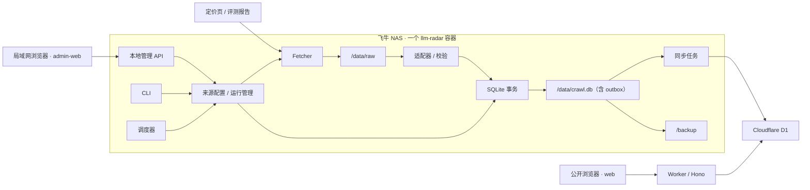

# LLM Radar 项目架构

首个交付目标是在飞牛 NAS 上完成一次可追溯的采集：从真实页面取得报价和评测，能查到原文、采集时间、解析结果及失败原因。第二个目标是让管理员在局域网浏览器里管理这些来源。即使尚未配置 Cloudflare，这两项也应能独立使用。业务规则和表结构基线见 [实施方案](../plan.md)，分阶段任务和接口见 [开发手册](development.md)。

## 部署与数据流



| 交付顺序 | 应用或共享目录 | 开发边界与独立运行条件 |
|---|---|---|
| 1 | `apps/llm-radar/` | Python 管理抓取、校验、SQLite、调度、备份和同步。CLI 是第一条完整入口。无 D1 凭据时记录公开变更待发送，`status` 显示“未配置同步”。 |
| 2 | `apps/admin-web/` | Vite、React、TypeScript 实现 NAS 管理页面。开发时 Vite 将管理请求代理到 Python；发布时静态产物随 Python 镜像交付。浏览器只访问同源管理 API。 |
| 3 | `apps/worker/` 与 `apps/web/` | Worker 的 Hono 路由读取 D1；公开 React 应用读取 Worker。两者作为 Cloudflare 交付物开发，与 NAS 镜像独立发布。 |
| 随使用方开发 | `apps/shared/` | 放公共迁移、NAS 专用迁移、跨语言数据契约及样例。每个应用继续使用自己的运行时和锁文件。 |

## 目标目录与代码归属

以下是按里程碑逐步创建的目录。根目录保留文档与仓库级配置，所有应用代码在 `apps/`。

```text
README.md · plan.md · docs/ · compose.yaml · .github/workflows/
apps/
├── llm-radar/
│   ├── pyproject.toml · uv.lock · Dockerfile
│   ├── config/default-sources.json
│   ├── src/llm_radar/
│   │   ├── cli.py · service.py · scheduler.py
│   │   ├── config.py · fetcher.py · parsers/
│   │   ├── normalize.py · store.py · fx.py
│   │   ├── syncer.py · backup.py
│   │   └── admin_api/             # Pydantic 请求/响应、认证、管理路由
│   └── tests/fixtures/             # 按来源保存脱敏页面、manifest 和预期输出
├── admin-web/
│   ├── package.json · package-lock.json · vite.config.ts
│   └── src/
│       ├── api/                   # 同源请求、响应类型、冲突与字段错误
│       ├── pages/                 # 状态、来源、评测核对、调度
│       └── components/            # 来源表单、预览表、运行详情
├── shared/
│   ├── contracts/                 # parser-result、公开 API、管理 API 样例
│   └── database/migrations/
│       ├── shared/                # NAS 与 D1 均执行
│       └── local/                 # 仅 NAS 执行
├── worker/                        # src/api/routes.ts、src/repo/readonly.ts
└── web/                           # src/；dist 由 Worker Assets 发布
```

| Python 模块 | 输入 → 输出 | 谁负责持久化 |
|---|---|---|
| `config.py`、`parsers/` | 加载运行参数和已登记的适配器。每个适配器声明参数结构、请求构造和分页结束条件；`parse(pages, params)` 返回 `ParseResult`。 | Parser 是纯函数。`secret_ref` 在执行请求时解析。 |
| `fetcher.py` | 请求计划 → 有序页面、响应元数据和完整性证据。处理超时、限速、磁盘空间和中断。 | Fetcher 在 `/data/raw` 写压缩页和 manifest。 |
| `normalize.py`、`fx.py` | 来源原值 → 模型映射、规范化报价、评测值或待核对记录；按 UTC 日期取得汇率。 | 将结果交给 Store。保留原币种、空值、版本和出处。 |
| `store.py` | 按来源应用校验结果，或按管理操作更新配置。 | 在短 SQLite 事务内写业务行、历史/审计和 outbox。显式管理事务和迁移版本。 |
| `service.py`、`scheduler.py` | CLI、管理 API 和定时器调用相同的采集与配置用例；服务负责启动、互斥、心跳和停止。 | 运行和来源结果记入 SQLite。配置变更从下一次运行生效；每轮固定已选的来源配置版本。 |
| `syncer.py`、`backup.py` | 按序消费公开记录、确认远端结果；按日生成一致性备份。 | 远端确认、积压和重试记录在 SQLite；备份副本写入 `/backup`。 |
| `admin_api/`、`cli.py` | 将 HTTP/命令行参数转换为用例输入，返回运行 ID、预览或操作结果。 | 写入统一经过服务用例，避免在三个入口各写一套回退或审核逻辑。 |

## 数据契约与所有权

| 数据 | NAS 保存什么 | 公开侧得到什么 |
|---|---|---|
| 来源 | `sources` 的公开属性，`source_configs` 的请求参数、适配器、映射与密钥引用；本地保存审核原因和配置版本 | 仅公开发布方、用途、适用厂商、类别、有效期、回退资格和公开出处等允许字段 |
| 价格 | `models`、`offers`、`price_history` 和 `fx_rates`；另存来源键和缺失次数 | 同源同档的原币价格历史和观测时间。查询时按请求时间选价，使官网报价在无新抓取时也能按时过期 |
| 能力评测 | 指标定义、版本、单位、方向、方法、测量条件、原报告及修订；模糊映射进入本地待核对表 | 通过校验的 `benchmark_metrics` 和 `evaluation_results`，包括评测方及原始报告链接 |
| 运行与恢复 | `crawl_runs`、`source_runs`、调度日期、outbox、同步位置、原始页和一致性备份 | D1 接受公开业务行。管理状态通过 NAS API 读取 |

公开选价的参考样例放在 `apps/shared/contracts/examples/`，每条包含候选记录、固定的 `as_of` 和预期选择。Python 预览和 Worker 查询各自执行相同样例，覆盖官方价刚好过期、官方停供和两家第三方优先级相同等边界。`as_of >= last_seen_at + valid_hours` 即过期；同级优先级数值小者在前，再按观测时间降序、稳定 ID 升序选取。

管理 API 由 Python 的 Pydantic 模型生成 OpenAPI，管理页面以该契约为准。公开 API 使用 `apps/shared/contracts/` 中的 JSON Schema。迁移 SQL 只维护在 `apps/shared/database/migrations/`，本地与 D1 各记版本。这样管理页面可以先于公开站点交付。

## 飞牛上的进程与存储

`llm-radar serve` 运行一个调度器和一个有序发送任务。启用管理功能时，在同一 Python 进程中启动 FastAPI/Uvicorn，使用一个服务进程，避免重复启动调度器。镜像增加 Node 构建阶段，将 `admin-web/dist` 复制到只读应用目录；Python 提供静态页面和 `/admin/api/v1`。开发时可以单独重启前端。所有数据库和 raw 的访问都留在 Python。

基础 Compose 只启动采集。启用管理功能时设置 `LLM_RADAR_ADMIN_ENABLED=true`，再用 Compose 覆盖配置将管理端口绑定到指定 NAS 局域网地址。建议容器内使用 `8080`；宿主机端口可配置。对外公开的 Cloudflare Worker 只持有自己的 D1 binding。

飞牛的本机目录绑定到 `/data`，包括 SQLite 辅助文件与 `raw/`；另一备份位置绑定到 `/backup`。容器重建沿用原挂载。部署参数在 `.env`，凭据由 `runtime.env` 注入，调度和来源配置持久化到 SQLite。详细挂载、保留期限和恢复顺序见 [实施方案](../plan.md) 第八、十、十一节。
